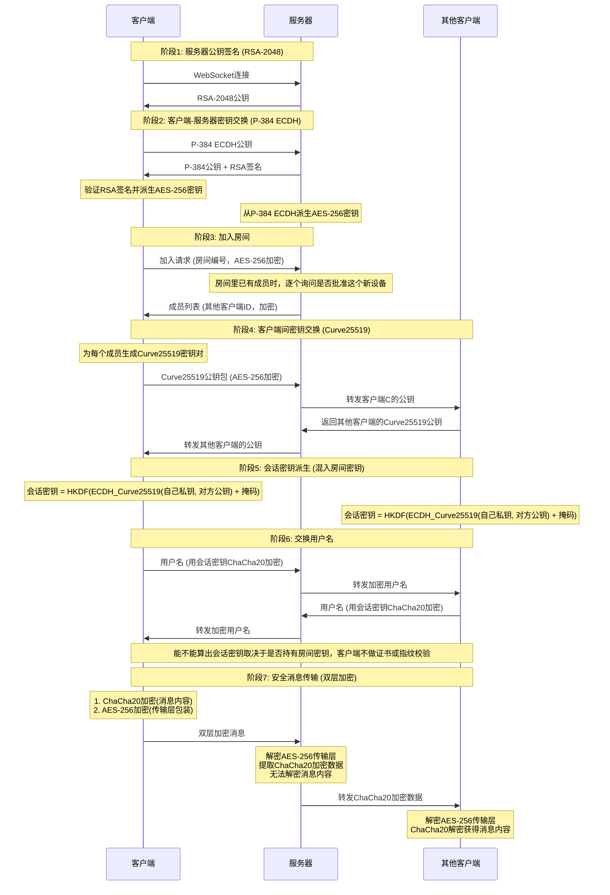

# NodeCrypt

**[English README](README_EN.md)**

## 部署说明

### 一键部署到 Cloudflare Workers

点击下方按钮即可一键部署到 Cloudflare Workers：

- 构建命令：npm run build
- 部署命令：npm run deploy
- 

## 项目简介

NodeCrypt 是一个端到端加密聊天系统，实现完全的零知识架构。房间密钥由分享链接的片段（网址 `#` 之后的部分）携带，浏览器不会把它发给服务器；密钥派生与消息加解密都在本机完成，服务器只转发它读不懂的内容。服务器能拿到的只有由房间密钥派生出来的房间编号。

### 系统架构
- **前端**：ES6+ 模块化 JavaScript，无框架依赖
- **后端**：Cloudflare Workers + Durable Objects
- **通信**：WebSocket 实时双向通信
- **构建**：Vite 现代化构建工具

## 零知识架构设计

### 核心原则
- **服务器盲转**：服务器只负责转发它读不懂的内容，既不存消息，也拿不到房间密钥
- **无数据库存储**：系统不使用任何持久化存储，所有数据仅在内存中临时存在
- **端到端加密**：消息从发送方到接收方全程加密，中转端拿不到解密需要的东西
- **历史不留存**：服务端不存任何消息，历史只存在于各设备的内存里，设备关闭即消失；新设备加入时，会从当时在线的设备同步到最近的一段公开聊天记录
- **匿名通信**：用户无需注册真实身份，支持临时匿名聊天
- **多样体验**：图片和文件走同一条传输管道，每个文件各自成一张卡片，图片、音频、视频与 Markdown 都能在卡片里直接预览。加文件有三个入口：点附件按钮挑选、把文件拖到页面任意位置，或者在页面任意位置按 Ctrl+V 粘贴（截图也算）。此外可选择主题与语言。

### 隐私保护机制

- **实时成员提醒**：房间在线列表完全透明，内任何人加入或离开都会实时通知所有成员，
- **新设备需要批准**：新设备进房要由房间里已有的设备点同意；被批准过的设备在服务端还记得它的那段时间里可以免审批回来，服务端实例重启后要重新批准
- **历史由设备提供**：新加入的设备会向房间里在线的设备索要最近的一段公开聊天记录（最多 500 条，只含公开文本与系统提示，不含文件与图片）；当时没有设备在线，就同步不到任何历史
- **私聊加密**：点击用户头像可发起端到端加密的私密对话，房间内其他成员完全无法看到私聊内容

### 房间密钥机制

房间密钥就是分享链接里那串 6 位码，它放在网址片段（`#` 之后）里。片段不随任何请求发送，因此服务器收不到它。

客户端用 PBKDF2-SHA256（十万次迭代，两个用途各用一个盐）从房间密钥派生两个值：交给服务器用于路由的**房间编号**，以及只留在本机的**掩码**。两台设备之间的会话密钥由两者共同决定：`会话密钥 = HKDF-SHA256(ECDH_共享密钥 ‖ 掩码)`。

- **房间隔离**：房间密钥不同，派生出的房间编号就不同，彼此看不到也解不开对方的通信
- **服务器看不见密钥**：服务器拿到的只有房间编号，而掩码用另一个盐派生，所以它算不出会话密钥。要读懂消息，它只剩暴力枚举房间密钥这一条路（6 位码约 30 位熵）
- **链接即邀请**：拿到链接的人可以进入该房间并解密其中的内容，请只发给信任的人

### 三层安全体系

#### 第一层：RSA-2048 服务器公钥签名
- 服务器实例启动时在内存里生成临时 RSA-2048 密钥对，实例重启（部署新版本、空闲回收、运行时更新）时会重新生成
- 客户端校验收到的 P-384 公钥确实由该 RSA 公钥签名，防止转发环节被塞进别的公钥
- 这份 RSA 公钥本身没有第三方背书，挡不住服务器自己换钥匙；真正让服务器读不到消息的是房间密钥
- 私钥仅在服务器内存中存在，从不写入存储

#### 第二层：ECDH-P384 密钥协商
- 每个客户端生成独立的椭圆曲线密钥对（P-384曲线）
- 通过椭圆曲线 Diffie-Hellman 密钥交换协议建立共享密钥
- 每个客户端与服务器之间拥有独立的加密通道

#### 第三层：混合对称加密
- **服务器通信**：使用 AES-256-CBC 加密客户端与服务器间的控制消息
- **客户端通信**：使用 ChaCha20 加密客户端之间的实际聊天内容
- 每条消息使用独立的初始化向量（IV）和随机数（Nonce）

## 完整加密流程详解

## 技术实现

- **Web Cryptography API**：浏览器原生加密实现，提供硬件加速
- **elliptic.js**：椭圆曲线密码学库，客户端之间的 Curve25519 由它实现；客户端与服务器之间的 P-384 用浏览器原生的 Web Cryptography API
- **aes-js**：纯 JavaScript AES 实现，支持多种模式
- **js-chacha20**：ChaCha20 流加密算法的 JavaScript 实现
- **js-sha256**：SHA-256 哈希算法实现

## 安全验证

### 加密过程验证
用户可通过浏览器开发者工具观察完整的加密解密过程，验证消息在传输过程中确实处于加密状态。

### 网络流量分析
使用网络抓包工具可以验证所有 WebSocket 传输的数据都是不可读的加密内容。

### 代码安全审计
所有加密相关代码完全开源，使用标准密码学算法，欢迎安全研究者进行独立审计。

## 安全建议

- **只把链接发给信任的人**：拿到链接就能进入该房间并解密其中的内容
- **需要更强强度就手输更长的码**：链接里默认是 6 位码（约 30 位熵），想更强可以直接输入更长的房间密钥，最长 26 位
- **使用最新版本的现代浏览器**：确保密码学 API 的安全性和性能

## 安全贡献

欢迎安全研究者报告漏洞和进行安全审计。严重安全问题将在24小时内修复。

## 开源协议

本项目采用 ISC 开源协议。

## 免责声明

本项目仅供学习和技术研究使用，不得用于任何违法犯罪活动。使用者应遵守所在国家和地区的相关法律法规。项目作者不承担因使用本软件而产生的任何法律责任。请在合法合规的前提下使用本项目。

---
## Star History

**NodeCrypt** - 真正的端到端加密通信

*"在数字时代，加密是保护隐私的最后一道防线"*
